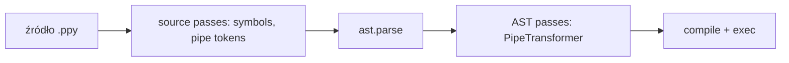

# PhysPy

Edytor Pythona z notacją fizyczną: piszesz `\rho_0`, widzisz ρ₀.
Plik zostaje zwykłym tekstem ASCII, a przed uruchomieniem transpiler zamienia rozszerzenia składni na czysty Python.

**Stack:** Tauri 2 (Rust) · CodeMirror 6 + KaTeX (TypeScript) · transpiler w Pythonie

## Struktura

```
├── index.html, src/            # frontend (Vite + TypeScript)
│   ├── main.ts                 # UI: toolbar, run, open/save, podgląd Pythona
│   ├── backend.ts              # wrappery na komendy Tauri
│   └── editor/
│       ├── mathSymbols.ts      # \rho_0 → ρ₀ (Decoration.replace + KaTeX)
│       ├── completion.ts       # autouzupełnianie po wpisaniu "\"
│       ├── symbols.ts          # tabela symboli + konwersja do LaTeX
│       └── setup.ts            # konfiguracja CodeMirror
├── src-tauri/                  # backend desktopowy (Rust)
│   └── src/lib.rs              # komendy: run_code, transpile, read_file, write_file
├── transpiler/                 # pakiet Pythona `physpy`
│   ├── src/physpy/
│   │   ├── symbols.json        # ← wspólne źródło prawdy (frontend też go importuje)
│   │   ├── symbols.py          # source pass: \rho_0 → ρ_0
│   │   ├── pipe.py             # przykład: x |> f → f(x) (token pass + AST pass)
│   │   ├── pipeline.py         # rejestr passów
│   │   ├── importer.py         # import hook dla plików .ppy
│   │   └── cli.py              # physpy run / physpy transpile
│   └── tests/
└── examples/demo.ppy
```

## Uruchomienie

Wymagania: Node 20+, Rust (stable), Python 3.10+, `uv` (do testów).

```bash
rustup default stable        # jeśli Rust nie ma ustawionego toolchaina
npm install
npm run tauri dev            # aplikacja desktopowa
npm run dev                  # sam frontend w przeglądarce (bez uruchamiania kodu)
npm run test:py              # testy transpilera
```

Transpiler można też używać bez edytora:

```bash
PYTHONPATH=transpiler/src python3 -m physpy run examples/demo.ppy
PYTHONPATH=transpiler/src python3 -m physpy transpile examples/demo.ppy
```

Zmienne środowiskowe backendu: `PHYSPY_PYTHON` (interpreter, domyślnie `python3`) i `PHYSPY_PATH` (katalog z pakietem `physpy`).

## Jak to działa



- **Source passes** (tekst → tekst) zachowują numery linii, więc tracebacki pokazują właściwą linię oryginalnego pliku.

### Obsługiwane rozszerzenia składni

| Składnia | Python | Pass |
|---|---|---|
| `\rho_0` | `ρ_0` | `symbols.py` |
| `export \rho_0 = 1000` | `ρ_0 = 1000` + zapis do `__exports__` | `exports.py`: udostępnia zmienną kolejnym komórkom (`# %%`); zmienne bez `export` są lokalne dla komórki |
| `plot plt`, `plot fig` | `__physpy_plot__(plt)` | `plotting.py`: renderuje wykres `matplotlib` (`plt`, `Figure`, `Axes` lub `ax.plot(...)`) bezpośrednio pod komórką |
| `2(a + b)` | `2*(a + b)` | `implicit_mul.py`: tylko literał liczbowy przed `(`, bo w Pythonie zawsze byłby to błąd (`int` nie jest wywoływalny) |
| `x^2`, `x^(n+1)` | `x**2`, `x**(n+1)` | `power.py`: w edytorze renderowane jako indeks górny (`x²`, `xⁿ⁺¹`); uwaga: nadpisuje bitowy XOR `^` |
| `x \|> f \|> g` | `g(f(x))` | `pipe.py` |

- `\rho_0` → `ρ_0`. Python akceptuje greckie litery w identyfikatorach, dzięki czemu `\lambda` nie koliduje ze słowem kluczowym `lambda`, a `\pi` z `math.pi`.
- Python normalizuje identyfikatory do NFKC, przez co np. `ϕ` i `φ` to **ta sama zmienna**. Z tego powodu w tabeli nie ma wariantów (`\varphi`, `\vartheta`…), a test `test_identifiers_are_valid_and_unique` pilnuje, żeby nie powstały kolizje.

### Dodawanie nowego rozszerzenia składni

1. Napisz pass tekstowy (`str -> str`) i/lub `ast.NodeTransformer`.
2. Dodaj go do `SOURCE_PASSES` / `AST_PASSES` w `pipeline.py`.
3. Dopisz testy w `transpiler/tests/`.

## Znane ograniczenia / TODO

- [ ] Kolumny w błędach są przesunięte po podmianie symboli (`\rho` → `ρ`), numery linii są poprawne.
- [ ] Wyrównanie komentarzy w edytorze „pływa”, bo ρ₀ jest węższe niż `\rho_0`.
- [ ] Brak zatrzymywania programu i strumieniowania wyjścia (wynik pojawia się po zakończeniu).
- [ ] Widok „Generated Python” używa `ast.unparse`, więc znikają komentarze.
- [ ] Wyrażenia `{...}` wewnątrz f-stringów nie są przetwarzane (`f"{\rho}"`).
- [ ] Release: dołączyć transpiler (i ewentualnie Pythona) jako zasób/sidecar Tauri.
- [ ] Diagnostyka na żywo w edytorze (podkreślanie błędów z transpilera).
