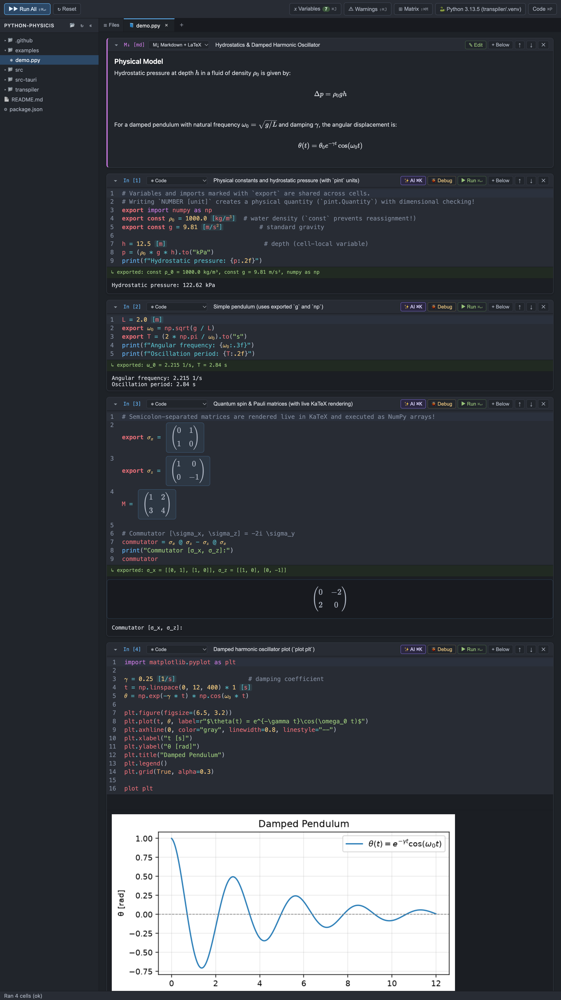

# PhysPy

A multi-platform desktop Python notebook and IDE built for physics and engineering calculations.
Write clean mathematical and physical expressions in plain ASCII (`\rho_0`, `x^2`, `[1, 2; 3, 4]`, `1000.0 [kg/m^3]`) — the editor renders them live as mathematical notation ($\rho_0$, $x^2$, $\begin{pmatrix}1 & 2\\3 & 4\end{pmatrix}$, `[kg/m³]`), and the transpiler converts them on the fly into standard Python.

**Stack:** Tauri 2 (Rust) · CodeMirror 6 + KaTeX (TypeScript/Vite) · `physpy` Python transpiler (`ast` + `tokenize` + `pint` + `matplotlib`)



---

## Key Features

### 1. Physics & Math Syntax Extensions
| PhysPy Syntax | Transpiled Python | Description |
|---|---|---|
| `\rho_0`, `\omega_0`, `\Delta x` | `ρ_0`, `ω_0`, `Δx` | Greek and physics symbols rendered live via KaTeX (with `\` autocomplete) |
| `[1, 2; 3, 4]`, `[a; b; c]` | `np.array([[1, 2], [3, 4]])` | Native matrix syntax with `;` row separators, rendered live in KaTeX as a 2D matrix widget and formatted as LaTeX matrix output |
| `15%`, `0.05% * v` | `0.15`, `0.0005 * v` | Percentage literals converted directly to numeric decimals |
| `1000.0 [kg/m^3]`, `p.to("kPa")` | `__physpy_unit__(1000.0, 'kg/m^3')` | Physical units powered by `pint` (`pint.Quantity`) with automatic dimensional analysis and `.to(...)` conversion |
| `const g = 9.81 [m/s^2]` | immutable constant | Blocks reassignment at the AST level and **immediately underlines reassignment attempts in red in the editor** |
| `export x = ...`, `export const ...`, `export import ...` | stored in `__exports__` | Explicit sharing of variables, constants, functions, classes, and imports across `# %%` cells |
| `2(\rho_0 + g)` | `2*(ρ_0 + g)` | Implicit multiplication after numeric literals before `(` |
| `x^2`, `x^(n+1)` | `x**2`, `x**(n+1)` | Exponentiation with `^` rendered as superscripts ($x^2$, $x^{n+1}$) in the editor |
| `x \|> f \|> g` | `g(f(x))` | Pipe operator |
| `plot plt`, `plot fig`, `plot ax` | `__physpy_plot__(plt)` | Inline rendering of `matplotlib` figures directly below the notebook cell |

### 2. Cell Notebook (`# %%`) with Isolated Scopes
- `.ppy` files are split into cells using `# %% Cell Title` markers while remaining plain, Git-friendly text files.
- By default, helper variables inside a cell are **local to that cell** — preventing namespace pollution across cells.
- Use the `export` keyword to explicitly share a variable, constant, function, class, or import with subsequent cells:
  ```python
  # %% Physical constants and hydrostatic pressure
  export import numpy as np
  export const \rho_0 = 1000.0 [kg/m^3]
  export const g = 9.81 [m/s^2]

  h = 12.5 [m]
  p = (\rho_0 * g * h).to("kPa")
  print(f"Hydrostatic pressure: {p:.2f}")

  # %% Quantum spin & Pauli matrices (with live KaTeX rendering)
  export \sigma_x = [0, 1; 1, 0]
  export \sigma_z = [1, 0; 0, -1]
  M = [1, 2; 3, 4]
  commutator = \sigma_x @ \sigma_z - \sigma_z @ \sigma_x
  print("Commutator [σ_x, σ_z]:")
  commutator

  # %% Simple pendulum
  L = 2.0 [m]
  export \omega_0 = np.sqrt(g / L)
  export T = (2 * np.pi / \omega_0).to("s")
  print(f"Period: {T:.2f}")
  ```

### 3. Desktop IDE Features
- **Visual Matrix Builder Dialog (`⊞ Matrix` / `⇧⌘M`)** — interactive grid modal with presets ($2\times2$, $3\times3$) and live KaTeX preview to insert matrix literals directly into the editor.
- **Interactive Step Debugger (`🐞 Debug` / `⇧⌘D`)** — line-by-line cell debugging with step over (`F10`), step into (`F11`), step out, continue, and live local variables inspector.
- **Code Formatter on Save (Black)** — automatic formatting of mathematical equations, arguments, and operators upon saving without line-length constraints (`format_on_save`, manual trigger `⇧⌥F`).
- **Single-File Static HTML Export (`⇧⌘E`)** — export notebooks to standalone, shareable HTML files with KaTeX math rendering, interactive collapsible code blocks, and embedded plots.
- **Collapsible File Explorer (`⌘B`)** — browse workspace folders and create, rename, or delete files and directories via the context menu.
- **VS Code-Style Editor Tabs** — open multiple files in tabs (`⌘N`, `⌘W`, middle-click to close, right-click tab context menu).
- **Variables Drawer (`⌘J`)** — live static + runtime scanner for all `export` and `export const` declarations in the file, showing current runtime values (including `pint` units and NumPy arrays), pending unexecuted exports, and duplicate export warnings.
- **Python Interpreter Selector** — modal dialog to switch the active Python environment (`.venv`, Conda, Homebrew, system Python, or custom binary path).
- **Transpiled Python Preview (`⌘P`)** — live side panel displaying the generated plain Python code.

---

## Project Structure

```text
├── index.html, src/            # Frontend (Vite + TypeScript + CodeMirror 6 + KaTeX)
│   ├── main.ts                 # UI: notebook cells, tabs, file tree, Variables drawer, Python dialog
│   ├── backend.ts              # Tauri command wrappers
│   └── editor/
│       ├── mathSymbols.ts      # Live rendering for \rho_0 → ρ₀ and x^2 → x² (KaTeX)
│       ├── constLint.ts        # Highlighting for const/export, [unit] literals, and const reassignment errors
│       ├── completion.ts       # Symbol autocomplete triggered on "\"
│       ├── symbols.ts          # Symbol table + LaTeX conversion
│       └── setup.ts            # CodeMirror 6 configuration
├── src-tauri/                  # Desktop backend (Rust / Tauri 2)
│   └── src/lib.rs              # Persistent Python worker (JSON-RPC), filesystem commands, Python discovery
├── transpiler/                 # Python package `physpy`
│   ├── src/physpy/
│   │   ├── symbols.json        # Shared symbol table (used by both frontend and Python transpiler)
│   │   ├── symbols.py          # \rho_0 → ρ_0 (including inside f-string interpolations)
│   │   ├── consts.py           # `const` keyword rewrite + AST immutability enforcement
│   │   ├── exports.py          # `export` keyword rewrite across notebook cells
│   │   ├── units.py            # Physical unit literals `1000.0 [kg/m^3]` (powered by `pint`)
│   │   ├── plotting.py         # `plot plt` / `plot fig` command (matplotlib → base64 PNG)
│   │   ├── implicit_mul.py     # Implicit multiplication `2(a + b)` → `2*(a + b)`
│   │   ├── power.py            # Exponentiation `x^2` → `x**2`
│   │   ├── pipe.py             # Pipe operator `x |> f` → `f(x)`
│   │   ├── notebook.py         # `# %%` cell splitter and isolated session runner
│   │   ├── pipeline.py         # Source & AST transpilation pipeline
│   │   ├── importer.py         # Import hook allowing `import module` for `.ppy` files
│   │   └── cli.py              # CLI: `physpy run`, `physpy transpile`, `physpy worker`
│   └── tests/                  # Pytest unit test suite
├── examples/demo.ppy           # Example physics notebook
└── .github/workflows/build.yml # CI/CD workflow building macOS, Windows, and Linux bundles on push to main
```

---

## Getting Started

### Prerequisites
- **Node.js** 20+
- **Rust** (stable toolchain)
- **Python** 3.10+ and [`uv`](https://docs.astral.sh/uv/)

### Local Development & Build

```bash
# 1. Create the Python virtual environment with dependencies (numpy, matplotlib, pint, pytest)
cd transpiler && uv sync && cd ..

# 2. Install frontend dependencies
npm install

# 3. Run the desktop app in development mode
npm run tauri dev

# 4. Build production desktop bundles (.app / .dmg / .msi / .deb / .AppImage)
npm run tauri build
```

### Using the Transpiler CLI Standalone

```bash
# Execute a .ppy file directly
cd transpiler && uv run physpy run ../examples/demo.ppy

# Print the transpiled plain Python code
cd transpiler && uv run physpy transpile ../examples/demo.ppy

# Run the test suite
cd transpiler && uv run pytest
```
